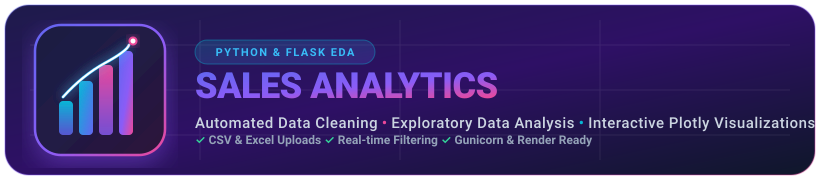
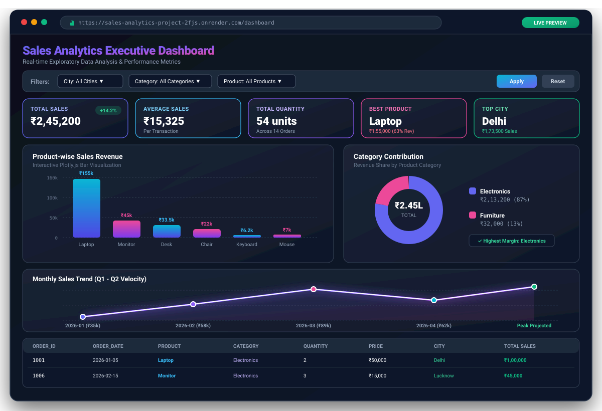
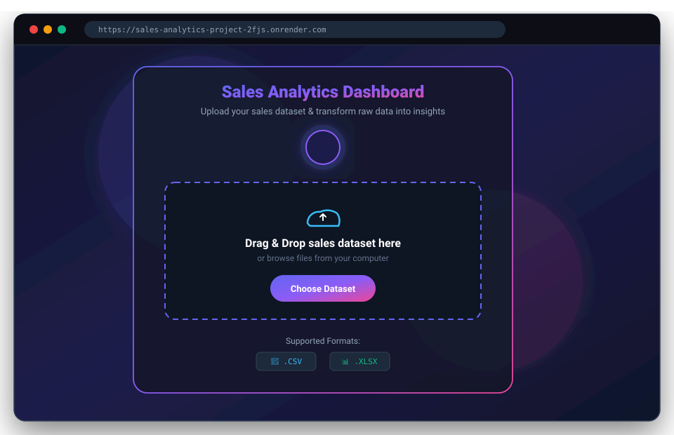
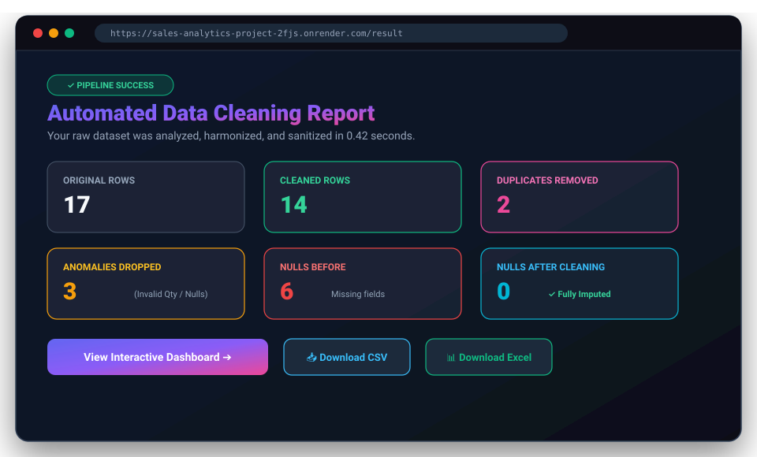
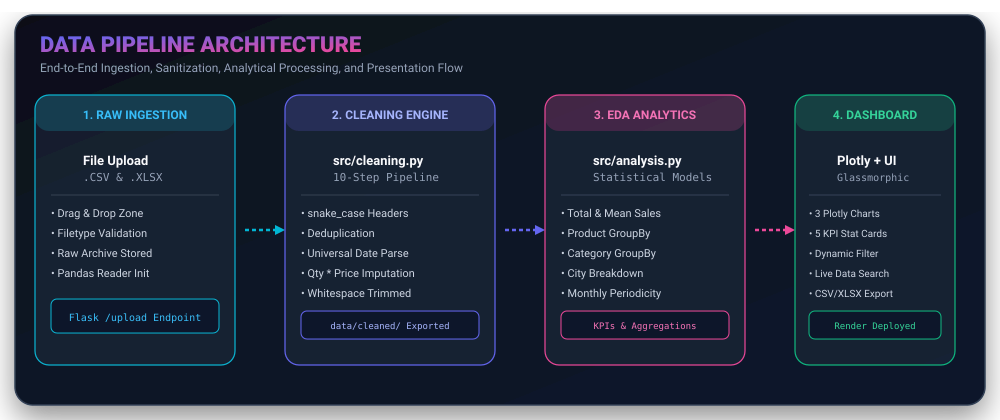

<p align="center">
  <a href="https://sales-analytics-project-2fjs.onrender.com" target="_blank" rel="noopener noreferrer">
    
  </a>
</p>

<h1 align="center">🚀 Enterprise Sales Analytics & Automated Cleaning Engine</h1>

<p align="center">
  <strong>An end-to-end, production-ready web application built with Python, Flask, Pandas, and Plotly.js.</strong><br>
  Transform messy, inconsistent sales datasets into pristine, production-ready data and dynamic executive dashboards in seconds.
</p>

<p align="center">
  <a href="https://sales-analytics-project-2fjs.onrender.com"><strong>🌐 Explore Live Application</strong></a> •
  <a href="#-quick-start"><strong>⚡ Quick Start</strong></a> •
  <a href="#-visual-showcase"><strong>📸 Interface Tour</strong></a> •
  <a href="#-automated-cleaning-pipeline"><strong>🧹 Cleaning Pipeline</strong></a> •
  <a href="https://github.com/Shresth-shukla-beginercoder/sales-analytics-project/issues"><strong>🐛 Report Issue</strong></a>
</p>

<p align="center">
  <!-- Language & Frameworks -->
  <a href="https://www.python.org/"></a>
  <a href="https://flask.palletsprojects.com/"></a>
  <a href="https://pandas.pydata.org/"></a>
  <a href="https://plotly.com/javascript/"></a>
  <br>
  <!-- Deployment & Repository Stats -->
  <a href="https://sales-analytics-project-2fjs.onrender.com"></a>
  <a href="https://github.com/Shresth-shukla-beginercoder/sales-analytics-project/stargazers"></a>
  <a href="https://github.com/Shresth-shukla-beginercoder/sales-analytics-project/network/members"></a>
  <a href="https://github.com/Shresth-shukla-beginercoder/sales-analytics-project/blob/main/LICENSE"></a>
  <a href="https://github.com/Shresth-shukla-beginercoder/sales-analytics-project/pulls"></a>
</p>

---

## 📑 Table of Contents

- [📌 Project Overview](#-project-overview)
- [📸 Visual Showcase](#-visual-showcase)
- [✨ Core Capabilities](#-core-capabilities)
- [🧹 The 10-Step Automated Cleaning Pipeline](#-the-10-step-automated-cleaning-pipeline)
- [📊 Exploratory Data Analysis (EDA) Engine](#-exploratory-data-analysis-eda-engine)
- [🏗️ System Architecture](#-system-architecture)
- [📂 Project Structure](#-project-structure)
- [⚡ Quick Start & Local Setup](#-quick-start--local-setup)
- [☁️ Cloud Deployment (Render)](#️-cloud-deployment-render)
- [🧪 Sample Dataset for Testing](#-sample-dataset-for-testing)
- [🛠️ Technology Stack](#️-technology-stack)
- [🛣️ Product Roadmap](#️-product-roadmap)
- [🤝 Contributing](#-contributing)
- [👨‍💻 Author](#-author)
- [📜 License](#-license)

---

## 📌 Project Overview

In real-world business workflows, sales datasets exported from ERPs, CRM platforms (Salesforce, HubSpot), or point-of-sale systems are plagued with quality issues: duplicate transactions, inconsistent case formatting (`"electronics"` vs `"Electronics"`), chaotic date styles (`"15-02-2026"` vs `"2026/01/05"`), negative or zero quantities, and missing revenue records.

**Sales Analytics** solves this challenge by offering a zero-configuration, automated ingestion and cleaning portal coupled with an executive analytics dashboard:

1. **Upload Messy Files:** Seamless drag-and-drop support for standard `.csv` and Excel `.xlsx` files.
2. **Automated Data Sanitization:** An intelligent 10-stage Python cleaning algorithm resolves duplicates, harmonizes dates, corrects negative values, trims whitespace, and calculates missing sales metrics (`Sales = Quantity × Price`).
3. **Data Quality Audit:** Instant Before-vs-After health scorecard summarizing dropped anomalies, resolved nulls, and deduplication statistics.
4. **Interactive Executive Dashboard:** High-impact business intelligence with KPI summary tiles, Plotly.js charts (Product Bar, Category Donut, Monthly Trend), multi-dimensional filters (City, Category, Product), and live client-side table searching.
5. **AI-Powered Analytics Assistant:** Integrated Gemini-powered chatbot allows you to ask natural language questions about your sales data, powered by secure, session-isolated DuckDB and MCP tool integration.
6. **One-Click Clean Export:** Export the cleansed dataset back to CSV or Excel for downstream machine learning or stakeholder presentation.

---

## 📸 Visual Showcase

### 1. Executive Analytics Dashboard
> Dynamic KPI stat cards, interactive Plotly visualizations, multidimensional filter controls, and live-searchable cleaned data table.

<p align="center">
  
</p>

---

### 2. Modern Drag & Drop Ingestion Portal & Cleaning Audit Report

<table width="100%">
  <tr>
    <td width="50%" align="center">
      <strong>📤 Drag & Drop Upload Portal</strong><br><br>
      
      <br><em>Supports CSV and Excel (.xlsx) formats with instant client-side drag-and-drop feedback.</em>
    </td>
    <td width="50%" align="center">
      <strong>🧹 Automated Cleaning Audit Report</strong><br><br>
      
      <br><em>Transparent before/after comparison showing deduplication, imputed nulls, and retention rates.</em>
    </td>
  </tr>
</table>

---

## ✨ Core Capabilities

| Feature | Description | Business Benefit |
| :--- | :--- | :--- |
| **🤖 AI Sales Assistant** | Natural-language querying powered by Google's Gemini API and an isolated DuckDB MCP engine. | Get instant conversational insights on top products, city breakdowns, and revenue anomalies. |
| **🦆 Session-Isolated DuckDB** | Ephemeral, per-session analytical databases guaranteeing multi-tenant security and zero data collisions. | Lightning-fast queries with robust data isolation and automatic cleanup on expiration. |
| **📁 Universal File Ingestion** | Drag & drop or browse `.csv` and `.xlsx` files with client & server-side format verification. | Eliminates manual file pre-processing; users can upload directly from their POS or ERP. |
| **🧼 10-Step Automated Pipeline** | Standardizes column headers, strips invisible whitespace, harmonizes casing, unifies dates, handles invalid quantities, and derives missing sales. | Transforms un-analyzable messy spreadsheets into clean, reliable data in < 1 second. |
| **📈 Statistical EDA Engine** | Computes key operational metrics: Total Revenue, Average Order Value (AOV), Volume, Top Selling Product, and Highest Grossing City. | Provides executives with immediate snapshot metrics without writing SQL or Pivot Tables. |
| **📊 Interactive Plotly Visualizations** | Hover-enabled, responsive bar charts, category distribution donuts, and monthly velocity curves with smooth zoom/pan. | Accelerates pattern detection, seasonal spike identification, and product mix analysis. |
| **🎛️ Dynamic Multi-Filter Slicing** | Filter datasets simultaneously by City, Category, and Product with instant dashboard updates and reset states. | Enables deep-dive investigative analysis by regional or product sales managers. |
| **🔍 Real-Time In-Browser Search** | Sub-second client-side table search filtering rows as you type across any column. | Rapid inspection of specific order IDs, products, customer cities, or dates. |
| **📥 Dual Format Export** | One-click export to sanitized `.csv` and formatted `.xlsx` files. | Seamless integration with Power BI, Tableau, or downstream Python ML pipelines. |
| **🎨 Glassmorphic Modern UI** | Built with custom CSS custom properties, aurora ambient glow, responsive grid, and custom SVG branding. | Clean, distraction-free aesthetic that looks stunning on mobile, tablet, and ultra-wide displays. |

---

## 🧹 The 10-Step Automated Cleaning Pipeline

Implemented in [`src/cleaning.py`](src/cleaning.py), the cleaning algorithm systematically purges anomalies:

```
Raw Upload (CSV / XLSX)
   │
   ├─► 1. Column Standardization ───► Strip spaces, lowercase, snake_case
   ├─► 2. Duplicate Removal ────────► Drop exact duplicate records
   ├─► 3. Whitespace Trimming ──────► Strip leading/trailing spaces in text
   ├─► 4. Categorical Casing ───────► Standardize to Title Case (City, Category)
   ├─► 5. Universal Date Parsing ───► Convert mixed formats (DD/MM/YYYY, ISO) to datetime
   ├─► 6. Numeric Coercion ─────────► Convert price, quantity, sales to numeric (errors="coerce")
   ├─► 7. Quantity Validation ──────► Flag negative or zero quantities as invalid (NA)
   ├─► 8. Missing Sales Derivation ─► Compute Sales = Quantity × Price where sales is null
   ├─► 9. Inconsistent Sales Fix ──► Re-compute Sales when recorded Sales <= 0 but Qty & Price valid
   └─► 10. Clean Export & Report ───► Store in data/cleaned/ and generate health metrics
```

### 📋 Transformation Matrix

| # | Step | Raw Input Example | Cleaned Output | Logic Applied |
| :-: | :--- | :--- | :--- | :--- |
| **1** | Column Headers | `" Order Date "`, `"Unit Price"` | `order_date`, `unit_price` | `.str.strip().str.replace(' ', '_').str.lower()` |
| **2** | Deduplication | Order 1003 repeated twice | 1 unique row retained | `df.drop_duplicates()` |
| **3** | Whitespace | `" Delhi "` | `"Delhi"` | `.select_dtypes("object").str.strip()` |
| **4** | Case Standardization | `"electronics"` / `"ELECTRONICS"` | `"Electronics"` | `.str.title()` across key dimensions |
| **5** | Date Normalization | `"07/01/2026"`, `"2026-01-07"` | `2026-01-07` | `pd.to_datetime(..., dayfirst=True)` |
| **6** | Numeric Coercion | `"50000"` (str), `"$1,200"` | `50000.0`, `1200.0` | `pd.to_numeric(..., errors="coerce")` |
| **7** | Quantity Validation | `quantity = -1` or `0` | `pd.NA` | Negative/zero quantities converted to nulls |
| **8** | Missing Sales Imputation | `Quantity = 2, Price = 50000, Sales = NaN` | `Sales = 100000.0` | `df['sales'] = df['quantity'] * df['price']` |
| **9** | Corrupted Sales Reconciliation | `Quantity = 4, Price = 3500, Sales = -14000` | `Sales = 14000.0` | Recalculated using valid positive factors |
| **10** | Storage & Audit | Raw & Cleaned separation | `data/cleaned/cleaned_sales_data.csv` | Independent storage preventing data overwrite |

---

## 📊 Exploratory Data Analysis (EDA) Engine

Engineered in [`src/analysis.py`](src/analysis.py), the analytical module aggregates high-level performance indicators:

- **Executive Financial KPIs**:
  $$\text{Total Sales} = \sum \text{sales}$$
  $$\text{Average Order Value (AOV)} = \frac{1}{N} \sum \text{sales}$$
  $$\text{Total Volume} = \sum \text{quantity}$$
- **Product Hierarchy Breakdown**: Ranks products by gross revenue, automatically isolating the `#1 Best Performing SKU`.
- **Geographic Clustering**: Aggregates sales by customer city to identify regional demand centers.
- **Category Composition**: Computes revenue contribution shares across Electronics, Furniture, Apparel, etc.
- **Monthly Trajectory**: Converts order dates into month periods (`YYYY-MM`) and tracks month-over-month growth patterns.

---

## 🏗️ System Architecture

<p align="center">
  
</p>

### Pipeline Life-Cycle
1. **User Action**: The client drops a `.csv` or `.xlsx` file into the glassmorphic drop-zone on the `/` route.
2. **Ingestion & Validation**: Flask's `/upload` endpoint validates file extension, saves the archive to `data/raw/`, and parses it into a Pandas DataFrame.
3. **Sanitization Engine**: `src.cleaning.clean_sales_data()` executes the 10-step cleaning algorithm and writes the result to `data/cleaned/`.
4. **Statistical EDA Processing**: `src.analysis.analyze_sales_data()` computes aggregates and generates Plotly JSON chart specifications.
5. **Session & Redirect**: A data cleaning audit report is saved to Flask `session` and the user is redirected to `/result` to inspect health metrics.
6. **Executive Dashboard**: From `/result`, users click through to `/dashboard` where Plotly.js renders charts, filters dynamically slice the data, and users can export sanitized files.

---

## 📂 Project Structure

```text
Sales-analytics-project/
│
├── app.py                      # Flask Application Controller & Routing Endpoints
├── requirements.txt            # Python Production Dependencies & Versions
├── README.md                   # Comprehensive Project Documentation
├── .gitignore                  # Git Ignore Rules (venv, caches, temp files)
│
├── data/
│   ├── raw/                    # Original uploaded CSV / Excel datasets (Audit Trail)
│   └── cleaned/                # Sanitized, production-ready exports
│
├── src/                        # Modular Business Logic & Data Processing
│   ├── __init__.py             # Python Package Initializer
│   ├── cleaning.py             # 10-Step Automated Data Cleaning Pipeline
│   └── analysis.py             # Statistical EDA & KPI Aggregation Engine
│
├── templates/                  # Modern Glassmorphic Jinja2 HTML Templates
│   ├── index.html              # Drag & Drop File Upload Ingestion Portal
│   ├── result.html             # Data Cleaning Audit & Health Report
│   └── dashboard.html          # Interactive Executive Analytics Dashboard
│
├── static/                     # Web Application Assets
│   ├── favicon.svg             # Custom Scalable Vector Favicon
│   ├── css/
│   │   └── style.css           # Glassmorphism, Aurora Gradients, Responsive UI
│   └── js/
│       ├── script.js           # Client-Side Search, Drag & Drop, Filtering
│       └── plotly.min.js       # Bundled Standalone Plotly Library
│
└── docs/                       # Project Documentation Assets & Visual Mockups
    └── images/
        ├── logo.svg            # Wide Brand Hero Banner
        ├── favicon.svg         # High-Res Vector Favicon
        ├── dashboard-preview.svg # Desktop Dashboard Browser Mockup
        ├── upload-preview.svg  # Drag & Drop Upload Portal Mockup
        ├── cleaning-report-preview.svg # Data Cleaning Report Mockup
        ├── pipeline-architecture.svg # End-to-End Architecture Diagram
        ├── icon-192.png        # PWA / Application Icon (192x192)
        └── icon-512.png        # PWA / Application Icon (512x512)
```

---

## ⚡ Quick Start & Local Setup

Follow these steps to run the application locally on your workstation:

### Prerequisites
- **Python 3.10+** (Tested up to Python 3.13)
- **Git** installed on your system
- Modern Web Browser (Chrome, Firefox, Edge, Safari)

### 1. Clone the Repository
```bash
git clone https://github.com/Shresth-shukla-beginercoder/sales-analytics-project.git
cd sales-analytics-project
```

### 2. Create and Activate a Virtual Environment

- **On Windows (PowerShell):**
  ```powershell
  python -m venv venv
  .\venv\Scripts\Activate.ps1
  ```

- **On Windows (Command Prompt):**
  ```cmd
  python -m venv venv
  venv\Scripts\activate.bat
  ```

- **On macOS / Linux:**
  ```bash
  python3 -m venv venv
  source venv/bin/activate
  ```

### 3. Install Dependencies
```bash
pip install --upgrade pip
pip install -r requirements.txt
```

### 4. Run the Flask Development Server
```bash
python app.py
```

### 5. Access the Web Application
Open your browser and navigate to:
```
http://127.0.0.1:5000
```

---

## ☁️ Cloud Deployment (Render)

This application is configured for production deployment using `gunicorn`.

### Production Deployment Instructions
1. Create a free account at [render.com](https://render.com).
2. Click **New +** ➔ **Web Service** ➔ Connect your GitHub repository.
3. Configure the following build & launch parameters:
   - **Environment:** `Python 3`
   - **Build Command:** `pip install -r requirements.txt`
   - **Start Command:** `gunicorn app:app`
4. Click **Deploy Web Service**.

> 🔗 **Live Demo URL:** [https://sales-analytics-project-2fjs.onrender.com](https://sales-analytics-project-2fjs.onrender.com)

---

## 🧪 Sample Dataset for Testing

Want to test the cleaning engine right away? Save this snippet as `test_sales_data.csv` and upload it:

```csv
Order_ID,Order_Date,Product,Category,Quantity,Price,City,Sales
1001,2026-01-05,Laptop,Electronics,2,50000,Delhi,100000
1002,2026-01-07,Mouse,Electronics,5,500,Gorakhpur,2500
1003,07/01/2026,Keyboard,electronics,3,1200,Lucknow,3600
1004,2026-02-02,Chair,Furniture,4,3500,Delhi,14000
1005,2026-02-08,Desk,Furniture,2,7000,Gorakhpur,14000
1006,15-02-2026,Monitor,Electronics,3,15000,Lucknow,45000
1007,2026-03-01,Laptop,Electronics,1,55000,Delhi,55000
1008,2026-03-05,Mouse,Electronics,10,450,Gorakhpur,4500
1009,2026-03-12,Chair,Furniture,2,4000,Lucknow,8000
1010,2026-03-20,Desk,Furniture,3,6500,Delhi,19500
1003,07/01/2026,Keyboard,electronics,3,1200,Lucknow,3600
1011,2026-03-25,Keyboard, Electronics,2,1300, Delhi ,2600
1012,,Mouse,Electronics,4,500,Gorakhpur,2000
1013,2026-04-02,Laptop,Electronics,-1,50000,Delhi,-50000
1014,2026-04-05,Chair,Furniture,2,,Lucknow,
1015,2026-04-10,Desk,Furniture,0,7000,Gorakhpur,0
```

Notice the intentional anomalies handled by the pipeline:
- Row 12 is an exact duplicate of Row 3 (removed).
- Inconsistent category casing (`"electronics"` vs `" Electronics"`).
- Irregular date notations (`"07/01/2026"`, `"15-02-2026"`, `"2026-01-05"`).
- Leading and trailing whitespace in city names (`" Delhi "`).
- Negative quantities (`-1`), zero quantities (`0`), and missing price/sales fields.

---

## 🛠️ Technology Stack

| Layer | Technology | Version | Purpose |
| :--- | :--- | :--- | :--- |
| **Backend Framework** | [Flask](https://flask.palletsprojects.com/) | `3.1.3` | Lightweight WSGI web framework and API routing |
| **Production Server** | [Gunicorn](https://gunicorn.org/) | `26.2.0` | UNIX WSGI HTTP Server for production deployment |
| **Data Cleaning** | [Pandas](https://pandas.pydata.org/) | `3.0.5` | High-performance DataFrame manipulation & transformation |
| **Numerical Computing** | [NumPy](https://numpy.org/) | `2.5.3` | Array operations and vectorized calculations |
| **Excel Parser** | [openpyxl](https://openpyxl.readthedocs.io/) | `3.1.5` | Reading and writing modern `.xlsx` workbooks |
| **Interactive Charts** | [Plotly.js](https://plotly.com/javascript/) | `7.1.0` | Client-side reactive graphs (Bar, Donut, Line charts) |
| **UI Templating** | [Jinja2](https://jinja.palletsprojects.com/) | `3.1.6` | Dynamic server-side HTML rendering |
| **Styling & Effects** | Modern CSS3 | Custom | Glassmorphism, Aurora ambient gradients, responsive flex/grid |
| **Interactivity** | Vanilla JavaScript (ES6) | Native | Drag & drop events, real-time table search, dynamic filtering |
| **Vector Graphics** | Scalable Vector Graphics | SVG | Custom resolution-independent logos, favicons, and mockups |

---

## 🛣️ Product Roadmap

- [x] Universal CSV & Excel Drag-and-Drop Ingestion
- [x] 10-Step Automated Data Cleaning Algorithm
- [x] Data Quality & Health Scorecard Report
- [x] Dynamic KPI Summary Tiles & Plotly.js Visualizations
- [x] Multi-Dimensional Filters (City, Category, Product) & Table Search
- [x] CSV & Excel Cleansed Dataset Downloads
- [ ] **Machine Learning Predictive Analytics**:
  - Time-series sales forecasting with Prophet / ARIMA
  - Anomaly detection on unusual order values
- [ ] **Customer Intelligence**:
  - RFM (Recency, Frequency, Monetary) Customer Segmentation
  - Customer Lifetime Value (CLV) scoring
- [ ] **Executive Reporting**:
  - Automated PDF executive summary generation with charts
  - Scheduled email delivery of weekly metrics
- [ ] **Security & Multi-Tenancy**:
  - User authentication (OAuth2 & JWT)
  - Role-Based Access Control (Admin / Analyst / Viewer)

---

## 🤝 Contributing

Contributions make the open-source community an incredible place to learn, inspire, and create. Any contributions you make are **greatly appreciated**!

1. **Fork the Project**
2. **Create your Feature Branch**:
   ```bash
   git checkout -b feature/AmazingFeature
   ```
3. **Commit your Changes**:
   ```bash
   git commit -m "Add some AmazingFeature"
   ```
4. **Push to the Branch**:
   ```bash
   git push origin feature/AmazingFeature
   ```
5. **Open a Pull Request**

Please review our issues page to find bugs to fix or features to request!

---

## 👨‍💻 Author

<p align="left">
  
  <strong>Shresth Shukla</strong><br>
  <em>Computer Science &amp; Engineering (Artificial Intelligence &amp; Machine Learning)</em>
</p>

- **GitHub:** [@Shresth-shukla-beginercoder](https://github.com/Shresth-shukla-beginercoder)
- **Project Repository:** [sales-analytics-project](https://github.com/Shresth-shukla-beginercoder/sales-analytics-project)
- **Live Application:** [sales-analytics-project-2fjs.onrender.com](https://sales-analytics-project-2fjs.onrender.com)

---

## 📜 License

Distributed under the **MIT License**. See [`LICENSE`](LICENSE) for more information.

Developed with ❤️ for academic, educational, and professional data analytics excellence.

<p align="center">
  <a href="#-enterprise-sales-analytics--automated-cleaning-engine"><strong>▲ Back to Top</strong></a>
</p>
